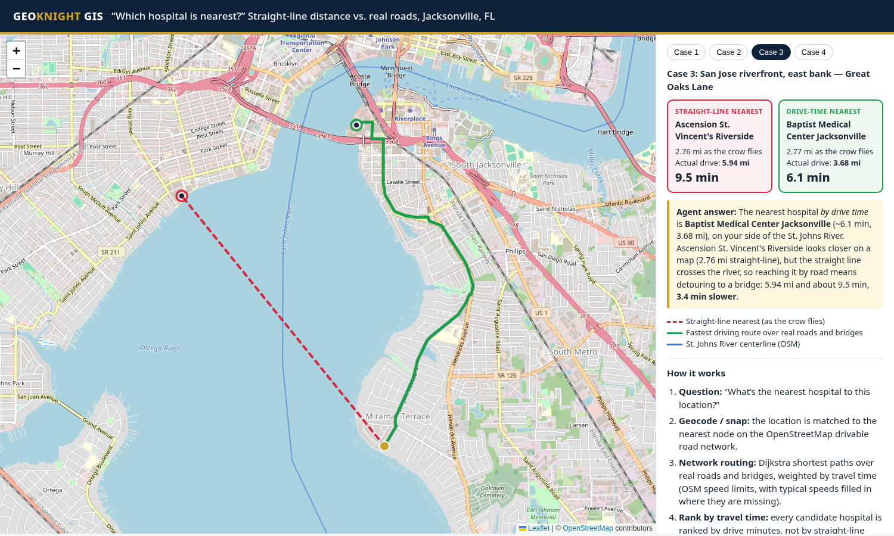

<p align="center"><b>GEOKNIGHT GIS</b> · Jacksonville, Florida</p>

# Nearest Hospital: Straight Line vs. Real Roads

**A small demo of an LLM + GIS-tools agent that doesn't make the "nearest hospital is across the river with no bridge" mistake.**

When you ask a plain language model, or a naive GIS query, "what's the nearest hospital?", it often ranks by straight-line distance. In Jacksonville the St. Johns River is a mile or more wide in places, and you can only cross it at a few bridges. So the hospital that looks closest on a map can be the slower one to reach. This demo puts the two answers side by side for real Jacksonville locations:

- 🔴 **red dashed line**: the straight-line nearest hospital (as the crow flies)
- 🟢 **green line**: the drive-time nearest hospital, routed over real OSM roads and bridges



## Results (computed, not hand-entered)

| # | Start point (OSM road node) | Straight-line pick | Drive-time pick | Time saved |
|---|---|---|---|---|
| 1 | North bank by the Dames Point Bridge — Mc Dowell St & Webster St | Memorial Hospital — 7.4 mi straight-line; 13.76 mi / **18.2 min** by road | University of Florida Health North — 9.49 mi / **11.8 min** | 6.4 min |
| 2 | Northside, north bank — Broward Cove Road & Broward Road | Baptist Medical Center Jacksonville — 5.65 mi straight-line; 8.77 mi / **11.2 min** by road | University of Florida Health North — 7.0 mi / **7.8 min** | 3.4 min |
| 3 | San Jose riverfront, east bank — Great Oaks Lane | Ascension St. Vincent's Riverside — 2.76 mi straight-line; 5.94 mi / **9.5 min** by road | Baptist Medical Center Jacksonville — 3.68 mi / **6.1 min** | 3.4 min |
| 4 | Mandarin, east bank — Hickory Bluff Lane & Scott Mill Road | HCA Florida Orange Park Hospital — 6.06 mi straight-line; 11.15 mi / **13.2 min** by road | Ascension Saint Vincent’s Southside Hospital — 8.26 mi / **11.7 min** | 1.5 min |

In every case the straight line to the "nearest" hospital crosses the St. Johns River centerline (OSM), and so does its fastest road route. The drive-time winner's route stays on the same bank (0 river crossings). `data/results.json` records these crossing counts.

## How it works

1. **Question:** "What's the nearest hospital to this location?"
2. **Geocode / snap:** match the location to the nearest node of the OSM drivable road graph. The test points are real road intersections, so the snap distance is 0.
3. **Network routing:** run Dijkstra over real roads and bridges (`networkx`), weighted by travel time. `osmnx` derives speeds from OSM `maxspeed` and fills in typical speeds by road class where that tag is missing.
4. **Rank by travel time:** sort every candidate hospital by drive minutes, not straight-line miles.
5. **Model explains:** the LLM agent calls these tools and explains the answer in plain language, including why the map-closest option is wrong ("it's across the river; the nearest bridge adds ~3 minutes").

## Run it

Open `index.html` in a browser. It's fully static: the results are pre-bundled in `data/results.js`, and the only network requests are for OSM tiles and Leaflet.

To recompute from scratch:

```bash
python3 -m venv .venv && .venv/bin/pip install -r requirements.txt
curl -L -A "your-app/1.0" -o /tmp/fl.pbf https://download.geofabrik.de/north-america/us/florida-latest.osm.pbf   # ~660 MB
.venv/bin/python scripts/clip_geofabrik.py /tmp/fl.pbf /tmp/duval_drive.osm data/hospitals_osm_raw.json  # Duval bbox: roads + hospitals
.venv/bin/python scripts/extract_river.py  /tmp/fl.pbf data/st_johns_centerline.geojson
.venv/bin/python scripts/scan.py            # optional: search road nodes for river-trap cases
.venv/bin/python scripts/compute.py data /tmp/duval_drive.osm   # writes results.json / results.geojson / results.js
rm /tmp/fl.pbf /tmp/duval_drive.osm         # intermediates aren't needed by the page
```

| File | Purpose |
|---|---|
| `index.html` | Leaflet map + side-by-side answer cards + "how it works" panel |
| `data/results.geojson` | Origins, straight lines, drive routes, and hospitals (precomputed) |
| `data/results.json` | Per-case numbers (miles, minutes, river crossings) |
| `data/hospitals_used.json` | Hospital set used for ranking |
| `data/candidates.json` | Test points (OSM node ids) |
| `scripts/*.py` | Clip, river extract, case scan, compute |

## Assumptions and limits

- **Hospitals:** named OSM `amenity=hospital` features in a Duval County bounding box, filtered to general acute-care hospitals. Rehab, psychiatric, specialty, freestanding-ER, and restricted military facilities are excluded (see `EXCLUDE` in `scripts/compute.py`). OSM has gaps: UF Health Jacksonville's downtown campus isn't tagged `amenity=hospital` in the 2026-10-31 extract, so it isn't a candidate. A production build would cross-check against HIFLD hospitals.
- **Travel times** assume free-flow speeds with no live traffic, signals, or turn penalties. Repeated runs can differ by ±0.1 min because ties between parallel edges are broken arbitrarily. Treat them as relative comparisons, not ETAs.
- This is a methodology demo, **not medical or navigation advice**.

## Data sources and credits

- Road network, hospitals, and river centerline: © [OpenStreetMap contributors](https://www.openstreetmap.org/copyright), available under the Open Database License (ODbL). The data comes from the [Geofabrik](https://download.geofabrik.de/) Florida extract dated 2026-10-31.
- Basemap tiles: © OpenStreetMap contributors.
- The HIFLD Hospitals layer (Homeland Infrastructure Foundation-Level Data) was the intended cross-check. The public endpoint timed out during this build, so this version uses OSM only.
- Libraries: OSMnx, NetworkX, pyosmium, Shapely, Leaflet.

## AI assistance disclosure

An AI assistant helped build this project (code, data processing, and documentation) under the direction of Christopher Knight, GeoKnight GIS. Every number on the page comes from the scripts in this repo running on public OpenStreetMap data.

## License

Code: MIT © 2026 GeoKnight GIS. Data in `data/` is derived from OpenStreetMap and stays under the ODbL.
