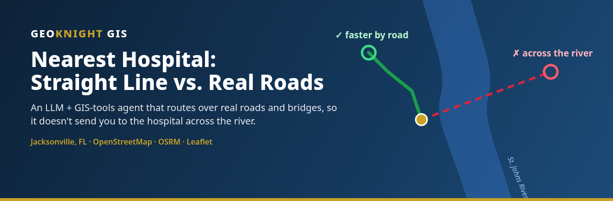
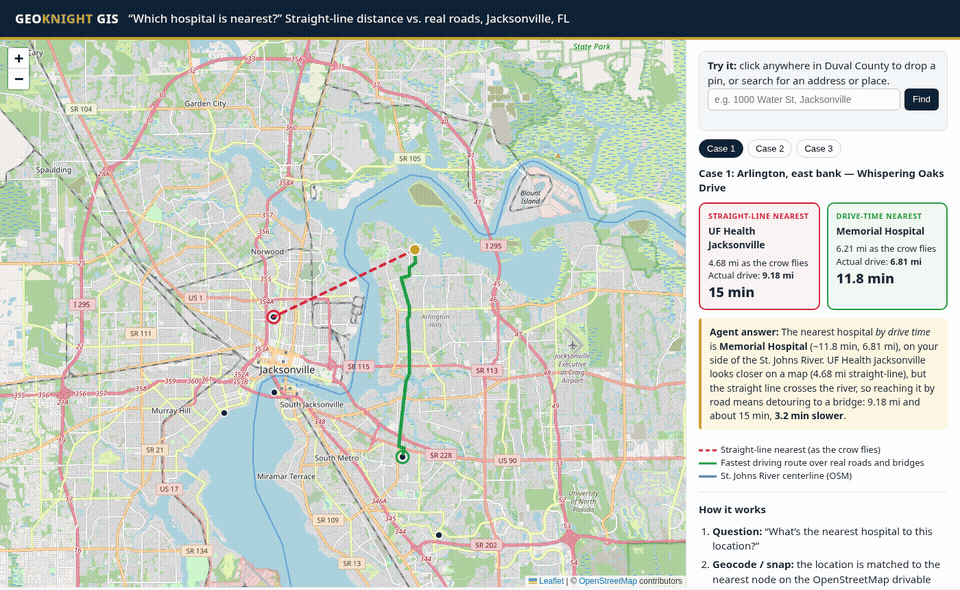
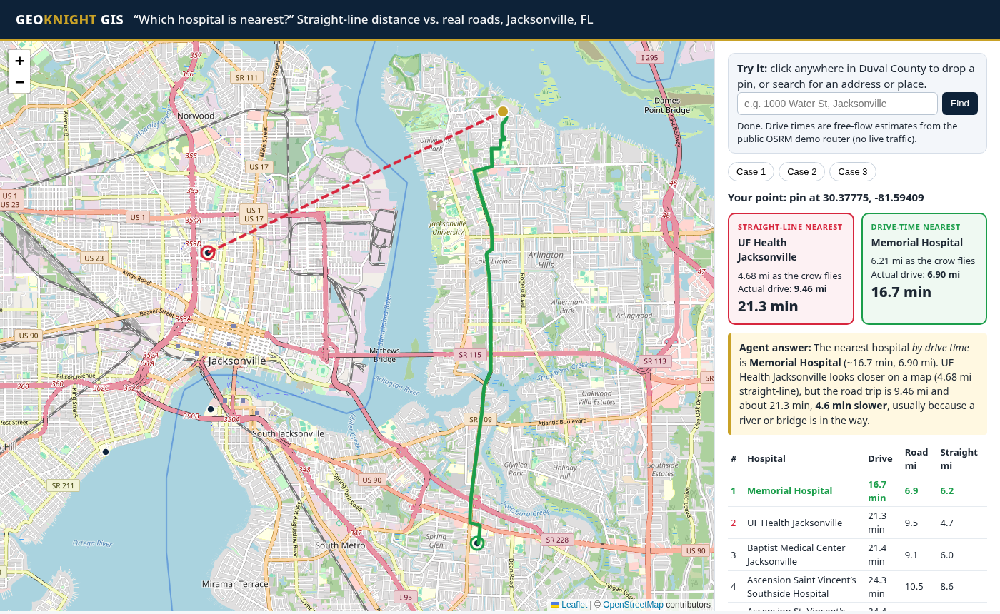

<p align="center">
  <a href="https://knightchrism.github.io/nearest-hospital-demo/"></a>
</p>

<p align="center">
  <a href="https://knightchrism.github.io/nearest-hospital-demo/"></a>
  <a href="LICENSE"></a>
  <a href="https://www.openstreetmap.org/copyright"></a>
  <a href="https://leafletjs.com/"></a>
  <a href="https://project-osrm.org/"></a>
</p>

<h3 align="center">👉 <a href="https://knightchrism.github.io/nearest-hospital-demo/">Try the live demo</a>: drop a pin anywhere in Jacksonville</h3>

---

## The problem

Ask an AI "what's the nearest hospital?" and it will often answer with straight-line distance. **In Jacksonville that can be the hospital across the St. Johns River**, which looks 2 miles away on a map but is a long detour by road to the nearest bridge.

This demo shows how an **LLM + GIS-tools agent** gets it right. It snaps your location to the real road network, routes over actual roads and bridges, and ranks hospitals by **drive time**, not by distance on a map.

<p align="center"></p>

<table><tr>
<td width="50%"><b>🔴 Straight-line nearest</b><br>The red dashed line is what a naive "nearest" query returns. It often crosses the river.</td>
<td width="50%"><b>🟢 Drive-time nearest</b><br>The green line is the fastest real route over roads and bridges, with miles and minutes.</td>
</tr></table>

## Results: precomputed river-trap cases

Computed with OSMnx/NetworkX on the OpenStreetMap road graph (free-flow speeds). Each case passed an automatic filter: the straight line ends on the **other** bank of the St. Johns River, and the drive-time winner's route crosses the river **zero** times.

| # | Start point (OSM road node) | ❌ Straight-line pick | ✅ Drive-time pick | Time saved |
|---|---|---|---|---|
| 1 | Arlington, east bank — Whispering Oaks Drive | UF Health Jacksonville — 4.68 mi straight-line; 9.18 mi / **15.0 min** by road | Memorial Hospital — 6.81 mi / **11.8 min** | 3.2 min |
| 2 | San Jose riverfront, east bank — Great Oaks Lane | Ascension St. Vincent's Riverside — 2.76 mi straight-line; 5.94 mi / **9.5 min** by road | Baptist Medical Center Jacksonville — 3.68 mi / **6.1 min** | 3.4 min |
| 3 | Mandarin, east bank — Hickory Bluff Lane & Scott Mill Road | HCA Florida Orange Park Hospital — 6.06 mi straight-line; 11.15 mi / **13.1 min** by road | Ascension Saint Vincent’s Southside Hospital — 8.26 mi / **11.7 min** | 1.4 min |

<p align="center"></p>

## How it works


1. **Question:** "What's the nearest hospital to this location?"
2. **Geocode / snap:** an address is geocoded with Nominatim, or a pin is dropped, and the point is snapped to the nearest node of the OSM drivable road graph.
3. **Network routing:** shortest paths over real roads and bridges, weighted by travel time.
4. **Rank by travel time:** every candidate hospital is sorted by drive minutes.
5. **Model explains:** the agent reports the answer in plain language, including why the straight-line pick is slower ("it's across the river; the bridge detour adds ~3 minutes").

## Live mode: drop a pin or search

Click anywhere in Duval County, or type an address or place. The page ranks all **11 hospitals** by drive time in your browser. It shows the straight-line pick (red dashed) against the drive-time route (green), with a ranked table of drive minutes, road miles, and straight-line miles. The three precomputed cases stay as presets.

- **Routing:** the [OSRM](https://project-osrm.org/) public demo server, which runs on OpenStreetMap data. Each pin makes one `table` request and one `route` request. Times are **free-flow estimates with no live traffic**, and they can differ from the precomputed OSMnx numbers. The demo server is shared and best-effort. If it's busy, the page says so and the presets still work.
- **Geocoding:** [Nominatim](https://nominatim.org/), following its [usage policy](https://operations.osmfoundation.org/policies/nominatim/). It sends one request per search, only when you submit, at most one per second, and only within Duval County.
- **No API keys and no backend.** Everything runs in the browser.

## Tech stack

| Layer | Tools |
|---|---|
| Data | OpenStreetMap (Geofabrik Florida extract), pyosmium clip to Duval County |
| Network analysis | OSMnx, NetworkX (Dijkstra on travel time), Shapely (river-crossing test) |
| Live routing / geocoding | OSRM public demo router, Nominatim |
| Front end | Leaflet, OSM tiles, vanilla JS; static GitHub Pages |

## Run locally

Open `index.html` in a browser (or run `python3 -m http.server`), or visit the [live page](https://knightchrism.github.io/nearest-hospital-demo/). It's fully static: the results are pre-bundled in `data/results.js`, and the only network requests are for OSM tiles and Leaflet.

To recompute from scratch:

```bash
python3 -m venv .venv && .venv/bin/pip install -r requirements.txt
curl -L -A "your-app/1.0" -o /tmp/fl.pbf https://download.geofabrik.de/north-america/us/florida-latest.osm.pbf   # ~660 MB
.venv/bin/python scripts/clip_geofabrik.py /tmp/fl.pbf /tmp/duval_drive.osm data/hospitals_osm_raw.json  # Duval bbox: roads + hospitals
.venv/bin/python scripts/extract_river.py  /tmp/fl.pbf data/st_johns_centerline.geojson
.venv/bin/python scripts/scan.py            # optional: search road nodes for river-trap cases
.venv/bin/python scripts/compute.py data /tmp/duval_drive.osm   # writes results.json / results.geojson / results.js
rm /tmp/fl.pbf /tmp/duval_drive.osm         # intermediates aren't needed by the page
```

| File | Purpose |
|---|---|
| `index.html` | Leaflet map, live mode, answer cards, and the "how it works" panel |
| `data/results.geojson` | Origins, straight lines, drive routes, and hospitals (precomputed) |
| `data/results.json` | Per-case numbers (miles, minutes, river crossings) |
| `data/hospitals_used.json` | Hospital set used for ranking |
| `data/hospitals_manual.json` | Manual hospital entries (OSM relations), with notes |
| `data/candidates.json` | Test points (OSM node ids) |
| `scripts/*.py` | Clip, river extract, case scan, compute |

## Assumptions and limits

- **Hospitals:** named OSM `amenity=hospital` features in a Duval County bounding box, filtered to general acute-care hospitals. Rehab, psychiatric, specialty, freestanding-ER, and restricted military facilities are excluded (see `EXCLUDE` in `scripts/compute.py`). **UF Health Jacksonville** (655 W 8th St, downtown) is mapped in OSM as an `amenity=hospital` multipolygon relation ([relation 14547184](https://www.openstreetmap.org/relation/14547184)), and the node/way clip skips relations. It's added by hand in `data/hospitals_manual.json`, using the OSM Nominatim centroid (30.3484582, −81.6649149). A production build would also parse relations and cross-check against HIFLD hospitals.
- **Travel times** assume free-flow speeds with no live traffic, signals, or turn penalties. Repeated runs can differ by ±0.1 min because ties between parallel edges are broken arbitrarily. Treat them as relative comparisons, not ETAs.
- This is a methodology demo, **not medical or navigation advice**.

## Data sources and credits

- **Road network, hospitals, and river centerline:** © [OpenStreetMap contributors](https://www.openstreetmap.org/copyright), ODbL, from the [Geofabrik](https://download.geofabrik.de/) Florida extract (2026-10-31).
- **Basemap tiles:** © OpenStreetMap contributors.
- **Live routing:** [Project OSRM](https://project-osrm.org/) public demo server. **Geocoding:** [Nominatim](https://nominatim.org/) (© OpenStreetMap contributors).
- **HIFLD Hospitals** was the intended cross-check. The public endpoint timed out during the build, so this version uses OSM only.
- **Libraries:** OSMnx, NetworkX, pyosmium, Shapely, Leaflet.

## AI-assistance disclosure

An AI assistant helped build this project (code, data processing, graphics, and documentation) under the direction of Christopher Knight, GeoKnight GIS. Every number comes from the scripts in this repo running on public OpenStreetMap data, or from live routing in your browser. None are hand-entered.

## License

Code: [MIT](LICENSE) © 2026 GeoKnight GIS. Data in `data/` is derived from OpenStreetMap and stays under the ODbL.

---

<p align="center"><b>GEO<span>KNIGHT</span> GIS</b> · Jacksonville, Florida · <a href="https://knightchrism.github.io/">knightchrism.github.io</a> · <a href="https://github.com/knightchrism">@knightchrism</a></p>
